  

  
  
  
  

I'm a software engineer from Cartagena, living in Medellín. By day I build clinical AI at **Hoag Health System**: AWS Bedrock agents that triage patients on a HIPAA telemedicine platform wired into Epic. By night I build my own products, and I write songs.

Most of what I make lives in private repos, so here is the work itself, live.

## Now building

<table>
  <tr>
    <td width="50%"></td>
    <td width="50%"></td>
  </tr>
  <tr>
    <td width="50%"></td>
    <td width="50%"></td>
  </tr>
</table>

Also on the bench: **Cancionero**, a private songwriting studio where Claude co-writes, a Spanish syllable and rhyme engine checks the meter, and demos come out of ElevenLabs Music.

## Path

## Toolbox

«Para siempre», my first single, is out November 26. <a href="https://musica.migueblanco.com">Put the record on.</a>

